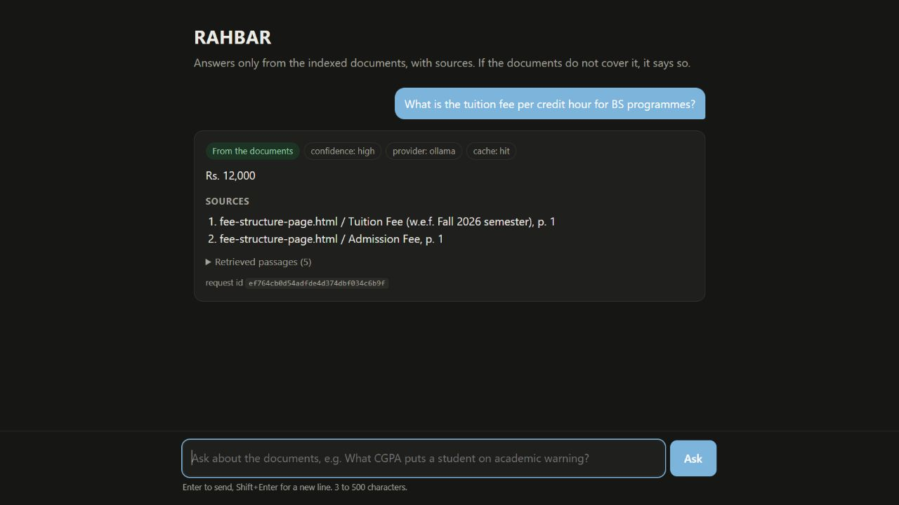
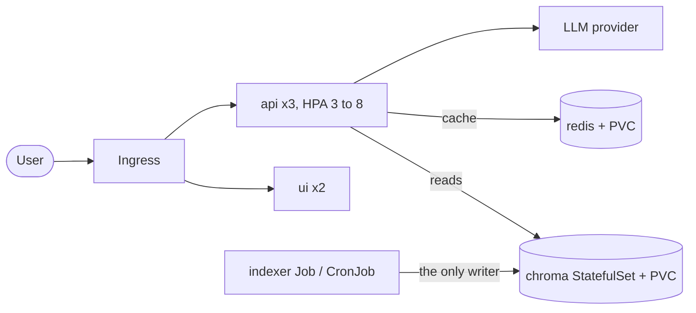

# RAHBAR


A student wants to know whether they can register for a course after failing its
prerequisite. The answer exists in a university PDF, but a general language model will
describe some other university's rules with complete confidence. RAHBAR is a grounded
question-answering service over a real document corpus (public FAST-NUCES documents). It
retrieves the relevant passages from a vector database that was indexed ahead of time,
generates a schema-constrained answer with citations, and declines when the documents do not
cover the question. It runs on Kubernetes, re-indexes without a redeploy, scales
horizontally, survives a deleted pod, and has a CI gate that fails when retrieval quality
drops.



## Architecture



More detail is in `docs/ARCHITECTURE.md`, and the decisions are in `docs/adr/`.

## Run it from a clean clone (Windows, PowerShell)

Prerequisites: Docker Desktop, minikube, kubectl, Python 3.12, and Ollama on your machine.

1. **Get the repository and the documents.** The FAST-NUCES files are not committed; the
   manifest lists each URL and SHA-256.
   ```powershell
   git clone --branch dev https://github.com/nofalzaman/Rahbar.git
   cd rahbar
   py -3.12 -m venv .venv
   .\.venv\Scripts\pip install httpx==0.28.1 pyyaml==6.0.2
   .\.venv\Scripts\python corpus/fetch.py
   .\.venv\Scripts\python corpus/fetch.py --verify
   ```
2. **Ollama on the host** (embeddings, and generation if you use `ollama-host`):
   ```powershell
   setx OLLAMA_HOST 0.0.0.0     # then restart Ollama
   ollama pull nomic-embed-text
   ollama pull llama3.2:3b
   ```
3. **Start the cluster.** Calico is required, or NetworkPolicy is silently ignored.
   ```powershell
   minikube start --driver=docker --cni=calico --memory=6144 --cpus=4
   minikube addons enable metrics-server
   minikube addons enable ingress
   minikube ssh "grep host.minikube.internal /etc/hosts"
   ```
   If that IP is not `192.168.65.254`, edit the two `ipBlock` entries in
   `k8s/base/networkpolicy.yaml`.
4. **Build the images and load them into minikube.** The indexer image holds the corpus:
   ```powershell
   docker build -t rahbar-api:dev api
   docker build -t rahbar-ui:dev ui
   docker buildx build --load -t rahbar-indexer:dev --build-context corpus=./corpus/raw indexer
   minikube image load rahbar-api:dev
   minikube image load rahbar-ui:dev
   minikube image load rahbar-indexer:dev
   ```
5. **Apply the manifests.** This creates the namespace, Chroma, Redis, the api, the ui, the
   Ingress, the HPA, the NetworkPolicies, and the indexer Job:
   ```powershell
   kubectl apply -k k8s/overlays/dev
   ```
6. **Only for the hosted LLM:** create the Secret from the command line (never from a file),
   set `LLM_PROVIDER`, `LLM_MODEL` and `HOSTED_BASE_URL` in `k8s/base/configmap.yaml`, apply
   again, and restart the api:
   ```powershell
   kubectl create secret generic rahbar-secret -n rahbar --from-literal=LLM_API_KEY="<key>"
   kubectl rollout restart deployment/api -n rahbar
   ```
7. **Wait for the index and the rollout:**
   ```powershell
   kubectl wait --for=condition=complete job/indexer -n rahbar --timeout=40m
   kubectl rollout status deployment/api -n rahbar
   kubectl get pods -n rahbar
   ```
8. **Ask a question through the Ingress.** Keep `minikube tunnel` running in another
   window, add `127.0.0.1 rahbar.local` to `C:\Windows\System32\drivers\etc\hosts`, then open
   http://rahbar.local/ or:
   ```powershell
   $body = @{ question = "What CGPA puts a student on academic warning?" } | ConvertTo-Json
   Invoke-RestMethod -Method Post -Uri http://127.0.0.1/api/ask -Headers @{ Host = "rahbar.local" } -ContentType "application/json" -Body $body
   ```
   Then ask about something the corpus does not cover (hostel rules): the service declines.
   Delete an api pod and ask again: nothing breaks.

## Re-index without a redeploy
```powershell
kubectl create job --from=cronjob/reindex manual-reindex-1 -n rahbar
```

## API
| Method | Path | Purpose |
| --- | --- | --- |
| POST | /api/ask | Ask a question. Body: `question`, optional `follow_up`. Returns the answer, citations, retrieved chunks and `cached`. |
| GET | /healthz | Liveness: the process is alive. Touches no dependency. |
| GET | /readyz | Readiness: Chroma reachable, collection non-empty, embedding model matches, Redis reachable. 503 names what failed. |
| GET | /metrics | Prometheus metrics: requests, latencies, cache lookups, abstentions, fallbacks, tokens. |

## Evaluation and CI
`eval/golden.yaml` holds the golden questions. `python eval/run_eval.py --api http://127.0.0.1 --host rahbar.local` writes `eval/results.json` and fails on the gate in `docs/PIPELINE.md`.
The `ci` workflow runs lint, tests, manifest validation, image builds, a Trivy scan and an
end-to-end eval on a kind cluster. The `cd` workflow publishes images tagged with the commit
SHA to Docker Hub and deploys them to an ephemeral cluster. kind does not enforce
NetworkPolicy, so CI does not test the firewall rules; the local Calico demo does.

## Documents
`docs/CORPUS.md`, `docs/PIPELINE.md`, `docs/FAILURE-ANALYSIS.md`,
`docs/ENGINEERING-NOTES.md`, `docs/AI-USAGE.md`, `docs/adr/`, `docs/evidence/`.

## Measured status
The 17-question real-corpus run has recall@3 0.7333, recall@5 0.8000, 100% citation
validity and 100% must-abstain correctness. Version-sensitive recall is 50%; some
answerable questions decline or fall back. These automated gates do not certify answer
quality. Reindexing has a brief non-atomic delete/rename interval. See
`docs/PIPELINE.md` and `docs/FINAL-CHECKLIST.md` for evidence and remaining release actions.

To run checks locally after cloning:
```powershell
.\.venv\Scripts\pip install -r api/requirements-dev.txt -r indexer/requirements-dev.txt
.\.venv\Scripts\ruff check api indexer eval corpus
Push-Location api; ..\.venv\Scripts\pytest -q; ..\.venv\Scripts\mypy app; Pop-Location
Push-Location indexer; ..\.venv\Scripts\pytest -q; ..\.venv\Scripts\mypy pipeline; Pop-Location
.\.venv\Scripts\pytest -q eval/tests
.\.venv\Scripts\python scripts/check_submission.py
```
