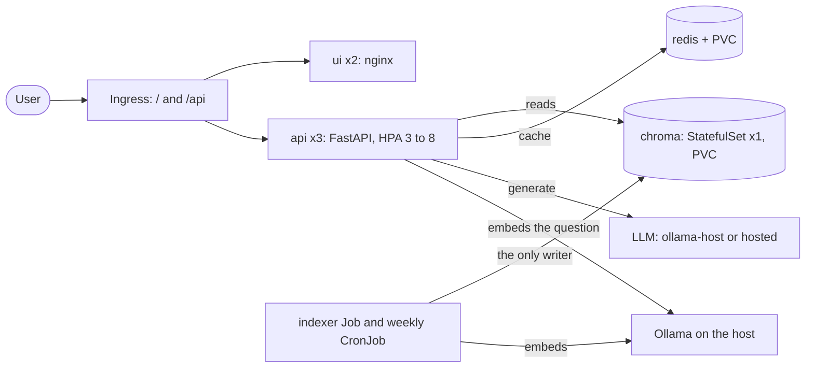

# Architecture

RAHBAR answers questions about FAST-NUCES documents only from those documents, cites its
sources, and says so when the documents do not cover a question.

## Two paths that never share a process
The indexer writes the vector store on demand and exits. The API only reads it, on every
question (see ADR 0001). Both read the same ConfigMap, so they cannot disagree on
`EMBED_MODEL`; the indexer also records it in the collection metadata and the API refuses
to become ready if it differs (`api/app/services/readiness.py`).

## Why Chroma is a StatefulSet
A Deployment can also mount a PVC, but a StatefulSet explicitly binds stable identity
`chroma-0` to its claim created by `volumeClaimTemplates`. One replica avoids two Chroma
processes using the same database volume. Replacement pods reattach that claim; losing
the volume still loses the index. The reason is predictable identity/storage lifecycle,
not an assertion that Deployments cannot persist data.

## Request path
1. The Ingress sends `/api/*` to the api and everything else to the ui.
2. The api embeds the question, checks the Redis cache, retrieves the top k chunks from
   Chroma (excluding superseded documents unless the question names an older version),
   drops passages under the relevance floor, and either abstains or asks the model for a
   schema-constrained answer.
3. The answer is validated, every citation is checked against the retrieved chunks, and it
   is cached only if it is safe to cache.

## Network policy (deny by default)
| From | To | Why |
| --- | --- | --- |
| Ingress controller | ui, api | the front door |
| ui | api | the page calls the API |
| api | chroma, redis | read the index, check the cache |
| indexer | chroma | the only writer |
| api, indexer | the host's Ollama (11434), api to HTTPS | embeddings and generation |
| every pod | kube-dns | name lookups |

The ui pod has no path to chroma or redis.

## Configuration
Non-secret settings are in `k8s/base/configmap.yaml`. The LLM key is a Secret created with
`kubectl create secret`; only a placeholder is committed.

## CI and CD
`ci.yml` (lint, test, manifests, build, scan, e2e eval on kind) gates every pull request to
`main`; `cd.yml` publishes images tagged with the commit SHA and deploys them to an
ephemeral kind cluster. kind does not enforce NetworkPolicy, so CI does not test the
firewall rules; the Calico minikube demo does.

## Limits
The delete/rename collection swap is not atomic. Readiness withholds empty or incompatible
indexes, but does not make a multi-step collection swap transactional. Citation checks
prove provenance, not factual correctness. See `PIPELINE.md` for measured quality limits.
